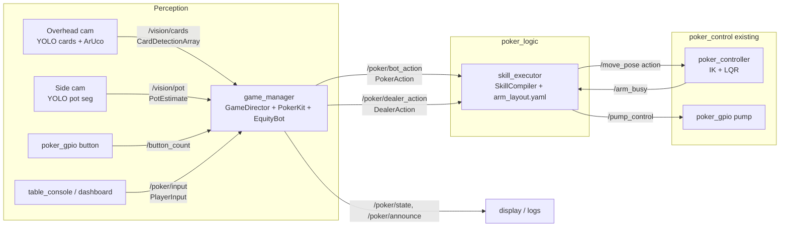

# poker_logic: decision layer for the poker arm

This package is the logic layer that sits between perception (cards, pot, buttons) and the
existing control stack. It is built from `poker_bot_demo_english` (the PokerKit rules engine
plus the Monte Carlo equity bot) and makes four changes to it:

| Demo (heads-up, on screen)                  | `poker_logic` (physical table)                                     |
|---------------------------------------------|--------------------------------------------------------------------|
| 2 players, random deck                       | 2 to 6 chairs (default 5). Cards come from vision or the dealer arm |
| Human clicks Fold / Call / Raise             | One "turn done" press. The action is inferred from the pot change  |
| Bot action is a log line                     | Bot action is a ROS 2 action that becomes `/move_pose` and `/pump_control` steps |
| No dealer                                    | Three modes: `player`, `dealer`, `dealer_player`                   |

Nothing in `poker_control`, `poker_gpio` or the controller had to change.

## Architecture



There are two nodes and a pure-Python core:

- **`game_manager`** (`nodes/game_manager_node.py`) is a thin ROS wrapper around
  `core/director.py`. The director is a state machine that reads stable cards, pot
  readings and button presses, keeps the PokerKit hand in sync with the real table, asks
  the policy for a decision on the bot's turn, and emits arm commands.
- **`skill_executor`** (`nodes/skill_executor_node.py`) turns `PokerAction` and
  `DealerAction` goals into a sequence of `/move_pose` goals and pump on/off commands. It
  uses the same pattern as `poker_demo/pick_demo_node.py` and waits for `/arm_busy` to
  clear between moves. Run it with `dry_run:=true` to log the motion plan instead of
  moving the arm.
- **`core/`** has no ROS dependency, so it can be unit-tested and simulated on a laptop.

| File | Role |
|---|---|
| `core/table.py` | `PhysicalTable`: PokerKit with cards supplied from outside. Unseen cards are dealt as `??`. Maps physical chairs to engine seats, rotates the button, handles busted players, refunds uncalled bets, and splits pots in whole chips |
| `core/observation.py` | The demo's observation, generalised to N players. It contains the bot's own cards and public information only |
| `core/equity.py` | The demo's equity estimator, extended to multiway pots with a per-opponent raise-weighted range. Uses `treys` (about 18x faster) with a fallback to PokerKit |
| `core/policy.py` | The demo's `EquityBot`. Thresholds are re-centred on the multiway fair share, and bet sizes are rounded to the smallest chip |
| `core/inference.py` | Turns a pot delta into fold, check, call or raise |
| `core/tracker.py` | Debounces card detections (k of N frames) and takes the median pot reading |
| `core/director.py` | `GameDirector` state machine, including the three modes |
| `core/skills.py` | Compiles skills into `MovePose` and `Pump` steps from `arm_layout.yaml` |
| `core/chips.py` | Chooses chips from the trays with an exact, inventory-aware split |
| `sim.py` | Offline table simulator with fake humans, noisy vision and an instant arm |

## Modes

| Mode | Who deals | Bot plays | Arm does |
|---|---|---|---|
| `player` | Humans. The bot's two cards are placed face-up in its holder | yes | Bets, calls, checks (tap) and folds (cards to muck) |
| `dealer` | Arm | no | Resets the deck, deals hole cards face-down to each chair, burns, and deals the board face-up |
| `dealer_player` | Arm | yes | Everything above. The bot's own cards are dealt face-up into its holder |

Set the mode with `ros2 launch poker_logic poker_game.launch.py mode:=dealer_player`.

## How a hand flows

1. **Next hand.** After a hand ends, the system waits for a press. It also waits until the
   board and the bot holder read empty. The button then moves clockwise. If the bot is in
   a blind, it posts the blind with `PokerAction POST_BLIND`.
2. **Hole cards.** In dealer modes the arm deals two rounds starting at the small blind. The
   bot's cards go face-up into `bot_hole` so the overhead camera can read them. Other
   players' cards enter the engine as unknown `??` cards.
3. **Betting.** PokerKit knows whose turn it is and how much they owe. A human puts chips in
   the middle and presses the button (any change on `/button_count` counts). After
   `pot_settle_s`, the median pot reading is compared with the expected pot:

   | Chips added (snapped to `chip_unit`) | Action |
   |---|---|
   | 0, nothing owed | check |
   | 0, chips owed (or the FOLD input) | fold |
   | the amount owed, or the whole stack | call |
   | more than owed | bet or raise to (street bet + chips added) |

   An under-raise, an over-bet or a short call is announced with what to correct. A
   persistent vision offset is tracked as `pot_bias`.
   On the bot's turn, the director builds an observation, the `EquityBot` decides, and a
   `PokerAction` goal is sent. The engine only applies the action after the arm reports
   success. Afterwards the pot is re-read to check that the chips landed.
4. **Board.** In dealer modes the arm burns and deals. The engine accepts the new cards only
   once they are stable in the `board` zone.
5. **Showdown.** Each player turns their cards face-up in their `seat_<n>` zone, or presses
   the button to muck. Mucking is refused before an all-in run-out, because those hands
   must be tabled. The announcement says who gets the pot.

The director never blocks. If the arm fails, the game pauses with an error. The operator can
fix the table by hand and press the button to continue as if the move had succeeded.

## Interfaces added to `poker_interfaces`

| Interface | Direction | Purpose |
|---|---|---|
| `msg/CardDetection`, `msg/CardDetectionArray` | vision → logic | card code, optional zone, table-frame x/y, confidence. Publish every frame, including empty ones |
| `msg/PotEstimate` | vision → logic | total chips in the middle, with a confidence |
| `msg/PlayerInput` | buttons / UI → logic | `TURN_DONE`, `FOLD`, `NEXT_HAND`, `MANUAL_ACTION`, `SET_CARDS` |
| `msg/GameState` | logic → UI | hand, stage, phase, actor, board, pot, stacks, what the system is waiting for |
| `action/PokerAction` | logic → executor | `FOLD`, `CHECK`, `CALL`, `BET_RAISE`, `POST_BLIND` with a chip amount |
| `action/DealerAction` | logic → executor | `DEAL_HOLE`, `BURN`, `DEAL_BOARD`, `RESET_DECK`, `HOME` |

**Vision contract.** Card codes use rank then suit: `A K Q J T 9 … 2` followed by
`h d c s` (for example `Th`). `10h` is accepted too. Cards are assigned to zones using
`config/vision_zones.yaml` (rectangles in the ArUco table frame). A detector can fill in
`zone` itself instead.

## Running

```bash
# once
pip install -r requirements.txt          # adds pokerkit + treys to the workspace venv
./build.sh && source ./source_ws.sh

# terminal 1: control stack (unchanged)
ros2 launch poker_bringup poker_arm.launch.py mode:=pi_hardware_headless
# terminal 2: decision layer + skill executor
ros2 launch poker_logic poker_game.launch.py mode:=player seats:=5 bot_seat:=0
# terminal 3: manual table input (until vision is up, or as an override)
ros2 run poker_logic table_console
```

**Dry run without an arm or cameras.** Launch with `dry_run:=true`, then drive the game
from `table_console`:

```
pot 15                          # fake side camera: blinds in the pot
cards bot_hole Ah Kh            # fake overhead camera: bot's hole cards
add 10   then  d                # chair 3 calls 10 and presses "done"
cards board 2c 7h 9s            # flop
s                               # print /poker/state
```

**Offline simulation (no ROS):**

```bash
ros2 run poker_logic poker_sim --mode dealer_player --seats 5 --hands 50 -v   # or: cd src/poker_logic && python3 -m poker_logic.sim ...
python3 -m pytest src/poker_logic/test
```

## Calibration checklist

1. **`config/arm_layout.yaml`** is in the arm base frame, the same frame `/move_pose` uses.
   Teach each pose with the dashboard's Cartesian panel: home, check tap, the chip trays
   (`base_z` is the height of the last chip, plus the chip thickness), the pot drop point,
   the deck holder, burn, muck, the five board slots, the two bot holder slots, and one
   target per chair. The face-up release reuses the flip motion from `pick_demo`
   (`approach` and `release`), so tune it once per slot height.
2. **`config/vision_zones.yaml`** is in the ArUco table frame. It holds the board, the bot
   holder, `seat_<n>` showdown areas and the muck.
3. **`config/game.yaml`** holds blinds, `chip_unit` (the smallest chip value), stacks,
   `samples` (try 300 on a Pi), `pot_settle_s` and the debounce window.
4. Chip trays restart from the `count` values in the layout file. Publish to
   `/poker/tray_refill` (`std_msgs/Empty`) after topping them up.

## Known limits and assumptions

- **Python version.** PokerKit needs Python 3.11 or newer, so use ROS 2 Jazzy on Ubuntu
  24.04. The Humble/22.04 default of Python 3.10 will not import it.
- **One shared pot camera.** Actions are inferred from changes in the total pot, so
  players should put chips straight into the middle and press after each action. Per-seat
  bet zones would make this more robust.
- **Payouts are announced, not physical.** The table pushes the pot and returns uncalled
  bets by hand, including chips owed to the bot. The bot's chip trays are tracked only as
  inventory counts.
- **Bot hole cards.** The bot must be able to see its own hole cards, so the design
  assumes a holder the overhead camera can see but opponents cannot.
- **Policy strength.** The policy is the demo's explainable heuristic generalised to
  multiway pots. It is not GTO, and the multiway threshold scaling is a hand-tuned
  assumption.
