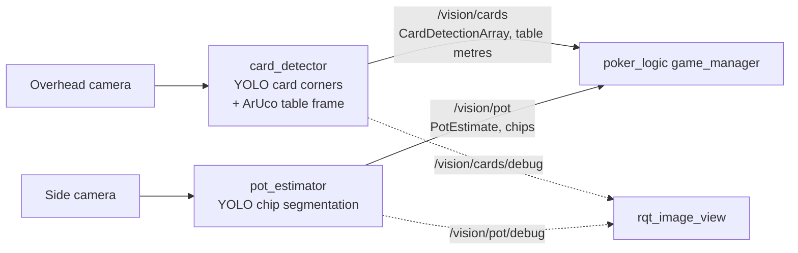

# poker_vision: cameras → poker_logic

This package turns the two cameras into the two topics that `poker_logic` already
consumes. Models, cameras and the table frame are all set in `config/vision.yaml`, so no
code changes are needed to swap weights or devices.



| Node | What it does |
|---|---|
| `card_detector` | Detects the ArUco markers to build the table frame, then runs the card-corner model. It merges the two corners of each card (the notebook's `process_card_centers`, with the pairing distance in metres), converts each card centre to table metres, and publishes `CardDetectionArray` every frame (an empty array when no cards are seen) |
| `pot_estimator` | Runs the chip segmentation model, counts chips per mask (by stack height, instance or area), multiplies by chip value, and publishes `PotEstimate` |
| `vision_probe` | The notebook workflow without ROS: run on an image or the camera, print cards with table and arm coordinates, and click to measure points |
| `export_model` | Converts `.pt` to ONNX or TensorRT |
| `make_marker` | Writes printable ArUco PNGs |

`poker_game_manager` assigns cards to zones using `poker_logic/config/vision_zones.yaml`.
That file must use the same table frame as `vision.yaml`. Use `vision_probe --click` to
measure the zone rectangles.

## Table frame (from `marker.py` / `marker.ipynb`)

- **`mode: scale`** is the notebook method. It computes metres per pixel from the marker
  perimeter, measures offsets from the marker centre, and treats image-down as −y. It is
  only exact for a camera looking straight down with the marker square to the image.
- **`mode: homography`** is the default. Each configured marker contributes its 4 corners
  at known table positions, and a plane homography maps pixels onto the table.
  - It handles camera tilt, rotation and perspective.
  - It can use several markers at once. Put 2–4 markers near the table corners for
    millimetre-level accuracy everywhere.
  - On synthetic tilted images it recovers points to under 3 mm with three markers. With a
    single 5 cm marker, points 18 cm away are off by about 1–2 cm.
- **Intrinsics:** `camera_matrix` and `dist_coeffs` are only used to undistort points. The
  notebook values are placeholders, and all-zero distortion means no undistortion.
- **Notebook `solvePnP` bug:** the cell lists the marker's 3D corners as TL, TR, BL, BR,
  but OpenCV returns them (and `SOLVEPNP_IPPE_SQUARE` expects them) as TL, TR, BR, BL.
  That cell's pose is therefore wrong. The homography here uses the correct order.
- **Arm frame:** `arm_from_table` (x, y, yaw) lets `vision_probe` print arm-frame
  coordinates, which is handy when teaching poses for `arm_layout.yaml`.

## Install

```bash
cd ~/poker_arm_ws && source .venv/bin/activate
pip install -r src/poker_vision/requirements.txt     # torch (CUDA 12 build), ultralytics, opencv
./build.sh --packages-select poker_interfaces poker_vision
source ./source_ws.sh
python -m pytest src/poker_vision/test -q             # 20 synthetic-image tests, no weights needed
```

Put the weights at the paths in `vision.yaml`, or edit the paths:

```
~/poker_arm_ws/models/cards.pt        # card corner detector (classes like AC, 5D, 10H)
~/poker_arm_ws/models/chips-seg.pt    # chip segmentation (classes -> class_values)
```

## Bring-up order

1. **Markers.** Run `ros2 run poker_vision make_marker --ids 0 1 2 3 --out ~/markers`.
   Print the markers, measure the black square, and enter each marker's size and table
   position in `table_frame.markers`.
2. **Still image check.** Run
   `ros2 run poker_vision vision_probe --image table.jpg --save out.jpg`. It should report
   the markers found with a fit error of a few mm, and list each card with its table
   coordinates.
3. **Zones.** Run `vision_probe --image table.jpg --click` and click the corners of the
   board area, the bot holder and each seat's showdown area. Copy the rectangles into
   `poker_logic/config/vision_zones.yaml`.
4. **Pot.**
   - Run `vision_probe --image side.jpg --pot` and set `class_values` to your model's class
     names.
   - Measure `px_per_chip`: the height of a 10-chip stack in pixels, divided by 10.
   - Optionally set an `roi` polygon so only the pot is counted, not the trays.
5. **Live.**
   ```bash
   ros2 launch poker_vision vision.launch.py
   ros2 run rqt_image_view rqt_image_view /vision/cards/debug
   ros2 topic echo /vision/cards
   ```
6. **With the game.**
   ```bash
   ros2 launch poker_logic poker_game.launch.py mode:=player
   ```
   The console is still useful for overrides.

**Testing without weights:** set `backend: mock` with `mock_detections` (see
`core/detector.py`) and use a still image as `source`. The whole chain then runs
end-to-end. It was tested that way: synthetic image → ArUco → corners → cards →
`game_manager` zones → bot hole cards read.

## GPU, ONNX and TensorRT (GTX 1650, 4 GB)

The backend is Ultralytics, which loads `.pt`, `.onnx` and `.engine` files with one API.
Speeding up is therefore just export, then edit `weights`, `task`, `device` and `half`.

| Setup | `vision.yaml` | Rough YOLOv8n-640 latency |
|---|---|---|
| CPU PyTorch | `weights: cards.pt`, `device: cpu` | 50–100 ms |
| GPU PyTorch FP16 | `device: cuda:0`, `half: true` | ~10–15 ms |
| ONNX Runtime GPU | `weights: cards.onnx`, `task: detect`, `device: cuda:0` | ~8–12 ms |
| TensorRT FP16 | `weights: cards.engine`, `task: detect`, `device: cuda:0`, `half: true` | ~4–8 ms |

These are typical numbers for a GTX 1650, not measured on your machine. At a 10 Hz frame
rate even plain GPU PyTorch is plenty. TensorRT mostly matters if you also run the
segmentation model at a high rate.

**1. Get CUDA working (Ubuntu 24.04 under WSL2).**
- **Windows side:** install a current NVIDIA Windows driver. That is all WSL needs. Do
  **not** install an NVIDIA Linux driver inside WSL.
- **Check inside Ubuntu:**
  ```bash
  nvidia-smi                                   # should list the GTX 1650
  python -c "import torch; print(torch.cuda.is_available(), torch.cuda.get_device_name(0))"
  ```
  The CUDA 12 PyTorch wheels from `requirements.txt` bring their own CUDA runtime, so no
  CUDA toolkit install is needed.
- **Native (non-WSL) Ubuntu:** run `sudo ubuntu-drivers install` instead, then reboot.

**2. Export.**
```bash
ros2 run poker_vision export_model ~/poker_arm_ws/models/cards.pt --format onnx       # needs: pip install onnx onnxslim onnxruntime-gpu
ros2 run poker_vision export_model ~/poker_arm_ws/models/cards.pt --format engine --half --device 0   # needs: pip install tensorrt
```
- A TensorRT engine only works on the GPU and TensorRT version it was built with, so build
  it on the machine that runs it.
- Keep `--workspace` at about 2 GB on a 4 GB card.
- If TensorRT gives trouble under WSL, ONNX Runtime GPU or PyTorch FP16 is a fine
  fallback.

**3. Memory.** Running both models on 4 GB is fine for nano and small models. Use `half`
to halve VRAM use.

## Cameras under WSL2

USB webcams aren't visible in WSL2 by default.
- **Attaching a camera:** use `usbipd-win` on Windows: `usbipd bind` then
  `usbipd attach --wsl --busid <id>`. Then check `ls /dev/video*` in Ubuntu. Some WSL
  kernels lack the UVC webcam driver. If no `/dev/video*` appears after attaching, that's
  the cause.
- **Fallbacks:**
  - Stream the camera from Windows (RTSP or HTTP MJPEG) and set `source: rtsp://...`, or
    any OpenCV-readable URL.
  - Run a ROS camera driver and set `source: ros:/camera/image_raw`.
  - Use native Ubuntu.
- **Test without a camera:** a still image or video file works as `source`.

## Config reference

All keys are documented inline in `config/vision.yaml`. The ones you will touch:

- **`*_camera.source`:** camera index, `/dev/videoN`, a file, a URL or `ros:<topic>`.
- **`*_camera.rate_hz`:** how many frames per second are processed.
- **`table_frame.markers`, `mode`, `lock_after_frames`:** marker poses, fit method, and an
  option to freeze the fit once the camera is fixed.
- **`card_model`:**
  - `weights`, `device`, `half`, `conf`: model file and inference settings.
  - `class_map`: only needed if class names aren't like `AC`, `10H`.
  - `pair_max_distance_m`: how far apart two corners of one card can be.
- **`pot_model`:**
  - `class_values`: chip value per class name.
  - `count_mode`, `px_per_chip`: how masks turn into chip counts.
  - `roi`: optional pot area, so trays aren't counted.
  - `round_to`: snap the total to the smallest chip.
