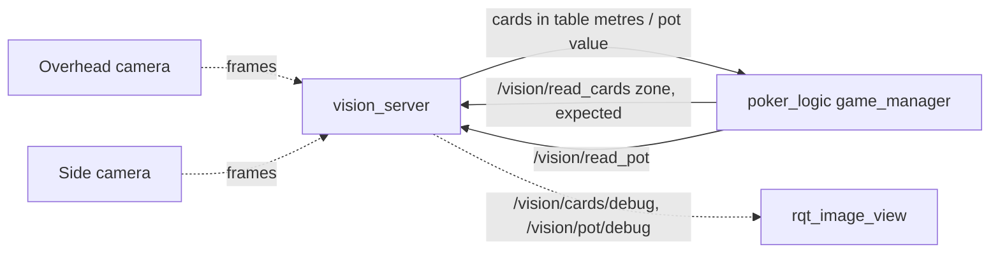

# poker_vision: on-demand card and pot reads

A single node, `vision_server`, answers two services. No model runs between requests.



| Service | When `game_manager` calls it | What happens |
|---|---|---|
| `/vision/read_cards` (`ReadCards`) | Bot hole cards needed, a board street dealt, a showdown. Always after the button press, or after the arm's last deal | Refresh the ArUco table frame, then crop the requested zone (+ margin) from the full-resolution still. Run YOLOv8-l at 640 on the crop only, map boxes back to the full image and table metres, merge corners into cards, keep the cards inside the zone, and check the count |
| `/vision/read_pot` (`ReadPot`) | After a human's turn press (+ `pot_settle_s`), and after the bot's chips land | Crop the pot ROI, run YOLOv8-l-seg at 1280 with only Blue/Red/White enabled, count one chip per mask, and sum White 1, Red 5, Blue 10 |

- **Cameras** keep grabbing frames on background threads, which is cheap. A read waits for
  a frame captured *after* the request, so hands that just left the frame are not in it.
- **Separate callback groups:** each service has its own, so a 2 s CPU pot read never
  delays a card read.
- **After every read** the node publishes its result (`/vision/cards`, `/vision/pot`) and an
  annotated still (`/vision/*/debug`). It can also save every still to `debug.save_dir`,
  which is useful for collecting more training data.

## Why on demand

On your CPU one chip segmentation takes ~2.3 s (736×1280, YOLOv8-l-seg), and the card
model is also a large model. Streaming both continuously would saturate the CPU, and a
Pi 5 even more so. In the simulator the logic needs about **10 reads per hand** (about 4
card reads and 6 pot reads), against hundreds of frames for a streaming design.

## Card reads: zone crops

The card model was fine-tuned at imgsz 640. On a whole-table frame each card corner is
only a few pixels after downscaling. Each zone (`board`, `bot_hole`, `seat_<n>`) is a
rectangle in table metres in `vision.yaml`. The read projects it through the homography
and crops just that region (plus `crop_margin_m`). Ultralytics then scales the crop up to
640, so the cards appear large, which generalises your manual crop of the board area.

- **Class names** (`10C` … `QS`) are parsed directly, so `class_map` stays empty.
- **Corner disagreements:**
  - A card's two corners are normally paired by class.
  - When the two corners disagree, the reader looks for lone corners that share a rank or
    a suit and sit diagonally at card-corner distance. An example is the 9S top-left with
    a 9C bottom-right in your sample. These are merged into one card with the higher
    confidence code and reported as a conflict.
  - The diagonal test keeps neighbouring cards in a row apart (7D next to 7H is not
    merged).
  - `conflict_policy: reject` makes such reads fail instead, so the operator confirms.
- **`shots: N`** reads N consecutive frames and keeps cards seen in the majority. It costs N
  inferences, so it is off by default.

## Pot reads

The chip model segments individual chips, so `count_mode: instance` (one mask = one chip).

- **Class filter:** `classes: [1, 2, 3]` tells Ultralytics to drop Black inside NMS, not
  afterwards.
- **ROI:** `roi: [x0, y0, x1, y1]` crops to the pot before inference. That removes
  background clutter and stray chips. In your sample the chips sit around y = 480–660 at
  1920×1080. The crop doesn't make a 1280 model much faster; the GPU does.
- **Other count modes:** `stack_height` and `area` remain for models trained on whole
  stacks or piles.

## Table frame

`homography` (the default) fits a plane homography to the corners of every visible
configured marker. `scale` is the original `marker.py` method. The last good fit is kept
when markers get covered (`max_age_s: 0`). The notebook's `solvePnP` cell uses the corner
order TL, TR, BL, BR, but OpenCV's is TL, TR, BR, BL, so that cell's pose is wrong; this
package doesn't use it.

## Setup and bring-up

```bash
pip install -r src/poker_vision/requirements.txt
./build.sh && source ./source_ws.sh
python -m pytest src/poker_vision/test -q        # 24 synthetic-image tests, no weights needed
```

1. **Markers.** Print them with `ros2 run poker_vision make_marker --ids 0 1 2 3`, then
   enter each marker's size and position under `table_frame.markers`.
2. **Zones.** Run `vision_probe --image overhead.jpg --click`. Zones are drawn on the
   image, and each click prints table coordinates. Edit `zones:`.
3. **Card reads.** Run `vision_probe --image overhead.jpg --zone board --expected 3`, and
   add `--full` to compare against the uncropped image. It prints the cards, any
   conflicts and the crop size.
4. **Pot.** Run `vision_probe --image side.jpg --pot`. It prints the value and the chips per
   colour. Then set `roi`.
5. **Live.** Run `ros2 launch poker_vision vision.launch.py`, then call it by hand to test:
   ```bash
   ros2 service call /vision/read_cards poker_interfaces/srv/ReadCards "{zone: board, expected: 3}"
   ros2 service call /vision/read_pot poker_interfaces/srv/ReadPot
   ros2 run rqt_image_view rqt_image_view /vision/cards/debug
   ```
6. **With the game.** Run `ros2 launch poker_logic poker_game.launch.py mode:=player`. Follow
   the instructions on `/poker/announce`; the `table_console` prints them.

**No weights or cameras?** Set `backend: mock` with `mock_detections` and use still
images as `source`. The whole chain was tested that way: button press → `read_cards` →
crop → cards → bot hole cards, then button press → `read_pot` → ROI crop → "call".

## GPU, ONNX and TensorRT (GTX 1650, 4 GB)

Switching is only a YAML change after exporting: `weights`, `task`, `device`, `half`.

| Setup | `vision.yaml` |
|---|---|
| CPU PyTorch | `weights: cards.pt`, `device: cpu` |
| GPU PyTorch FP16 | `device: cuda:0`, `half: true` |
| ONNX Runtime GPU | `weights: cards.onnx`, `task: detect`, `device: cuda:0` |
| TensorRT FP16 | `weights: cards.engine`, `task: detect`, `device: cuda:0`, `half: true` |

- **Getting CUDA (WSL2):** install a current NVIDIA *Windows* driver, then check
  `nvidia-smi` inside Ubuntu. The CUDA 12 PyTorch wheels need no CUDA toolkit.
- **Exporting:** `ros2 run poker_vision export_model ~/poker_arm_ws/models/chips-seg.pt
  --format engine --half --imgsz 1280 --device 0`. Build TensorRT engines on the machine
  that runs them.
- **Memory:** two large models in FP16 should fit in 4 GB because only one runs at a time.
  If VRAM is tight, keep the card model on GPU and the pot model on CPU; the two are
  configured separately.
- **Pi 5:** a YOLOv8-l-seg at 1280 will be slow on the CPU alone. Plan on a smaller model
  (v8s/n-seg retrained at 1280) or an accelerator such as the Hailo AI HAT.

## Cameras under WSL2

USB webcams need `usbipd-win` (`usbipd attach --wsl`). If `/dev/video*` doesn't appear,
stream from Windows (`source: rtsp://...`), use a ROS camera driver
(`source: ros:/camera/image_raw`), or use native Ubuntu. Still images work as `source` for
testing.
